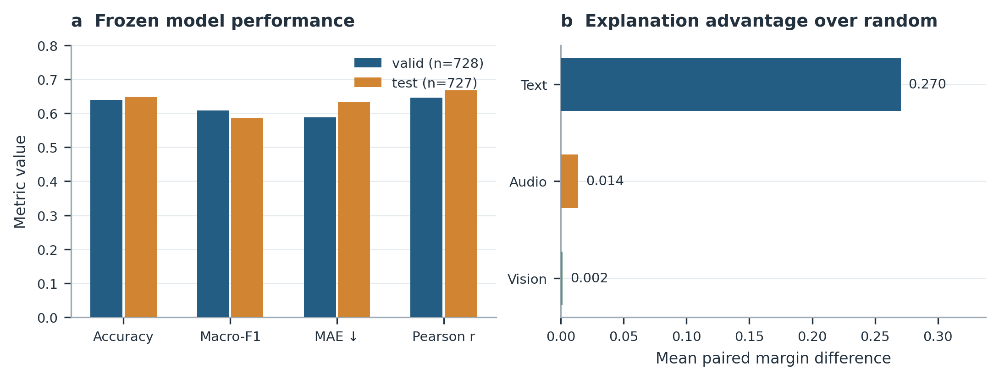
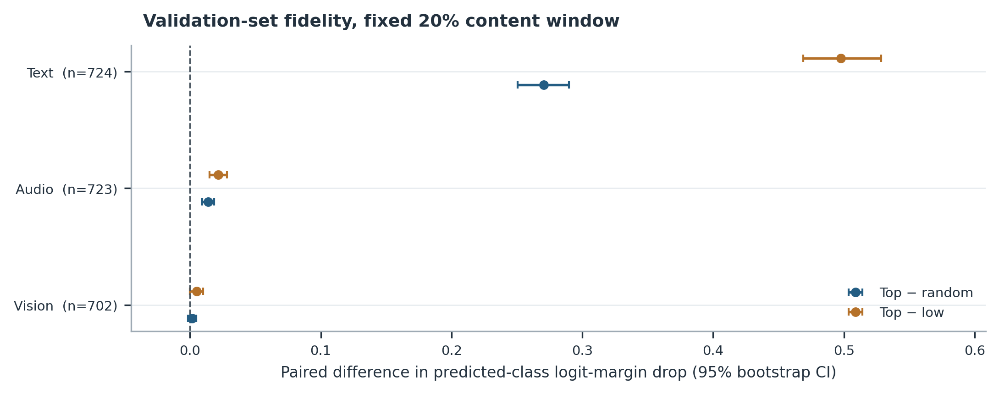
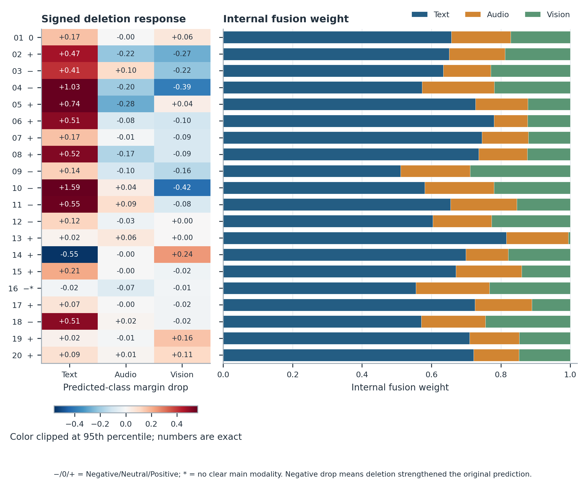
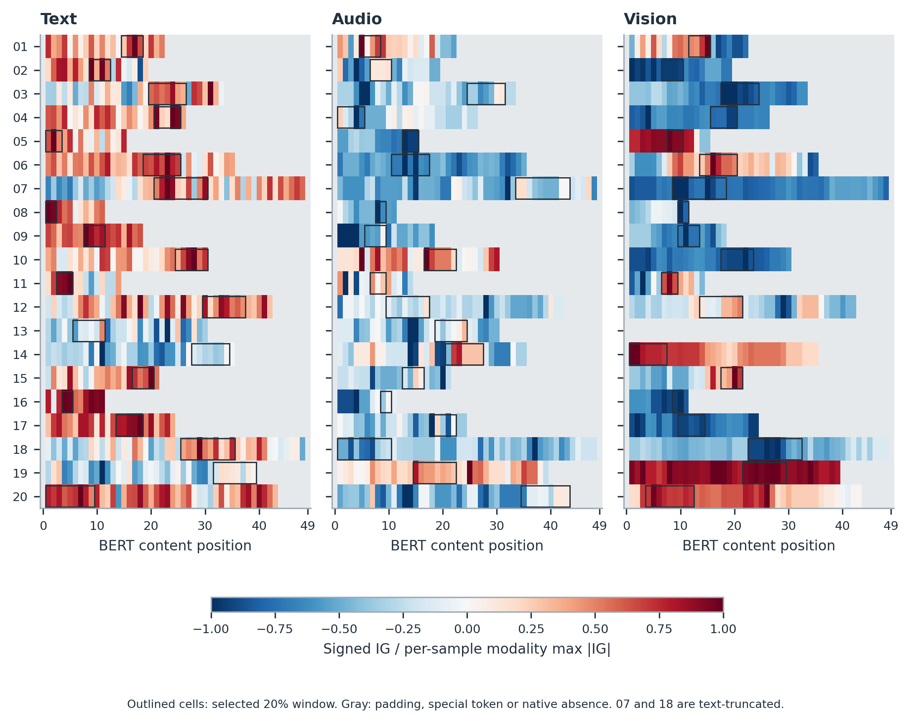
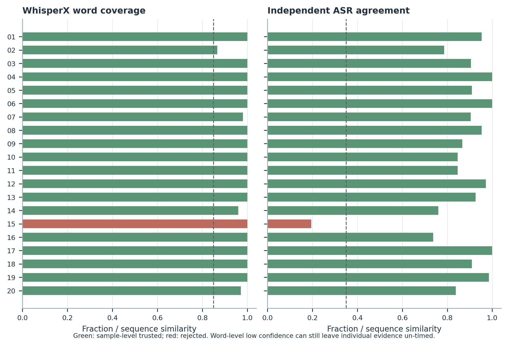
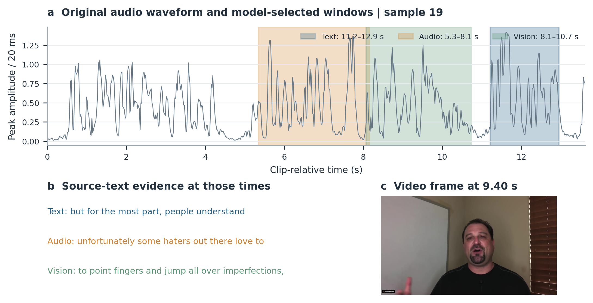
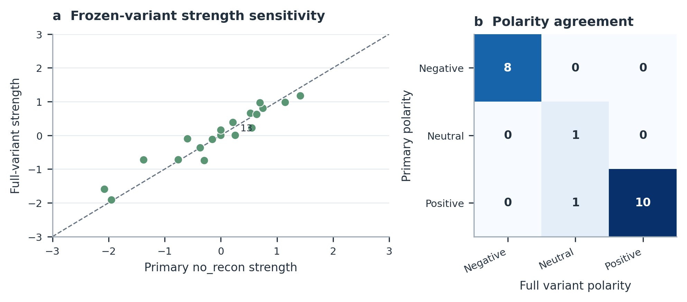
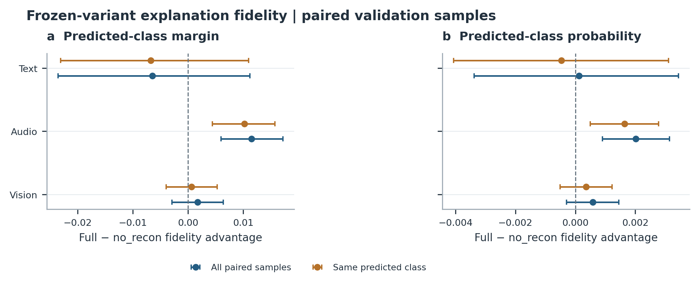
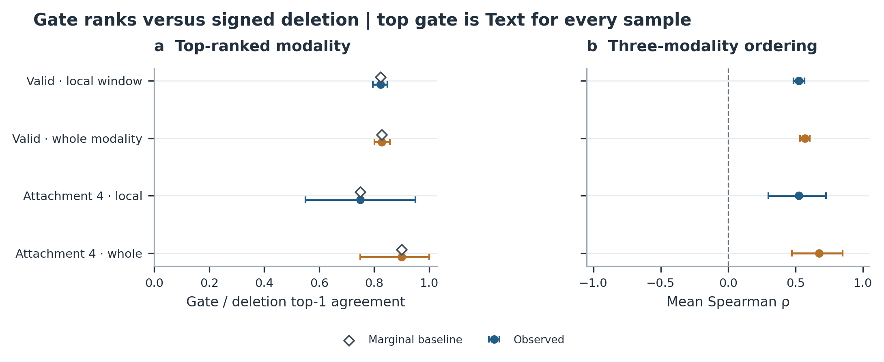

# 问题三：预测解释实验结果

冻结问题二的 MRRFNet no_recon 检查点，以三分类 logit margin 为解释目标；附件四的 20 个无标签样本没有参与模型训练、选模或总体忠实度估计，仅用于最终推理及无标签的数值、对齐核验。

## 预测性能

|划分|样本数|Accuracy|Macro-F1|MAE|Pearson r|
|---|---:|---:|---:|---:|---:|
|valid|728|0.639|0.608|0.587|0.646|
|test|727|0.649|0.586|0.632|0.667|

情感强度使用问题二既定的极性一致化输出；原始回归值仍在逐样本表中。

## 解释忠实度

验证集按真实类别比例、固定种子预先确定 728 条（本次覆盖全部验证集）。每模态以 48 步 IG 从输入的 10% 衰减参考点出发，提出 20% 内容长度的连续窗口，再独立删除该窗口，并和同长度、相同原生有效位置数的 8 次随机窗口及低 IG 窗口比较。遮挡同步将该模态对应位置的可用掩码置零；没有至少两个可匹配窗口的样本不计入该模态忠实度比较。下表报告关键段相对随机段的配对 logit-margin 下降差异；95% 区间为 2000 次样本 bootstrap。

|模态|n|关键−随机|95% CI|关键优于随机比例|关键段自身平均下降|
|---|---:|---:|---:|---:|---:|
|text|724|+0.270|[+0.251, +0.290]|92.8%|+0.378|
|audio|723|+0.014|[+0.009, +0.018]|59.2%|+0.007|
|vision|702|+0.002|[-0.002, +0.005]|55.6%|-0.018|

数值完备性检查：全验证集 |ΣIG−(margin(x)−margin(0.1x))| 平均 0.0055、最大 0.0969；附件四 20 条平均 0.0060、最大 0.0287。精确零特征基线附近的归一化路径数值变化很陡，因此固定采用 10% 衰减参考点；该参考点仍含部分原始信息，IG 代表相对衰减参考点的贡献，不代表从绝对无信息状态的因果效果。

视觉关键段相对随机段的配对优势 95% 区间跨零，且其自身平均遮挡响应为负：删除该段反而提高原预测类别的 margin。因此本实验没有证明视觉局部解释具有稳定正向忠实度，不能把视觉 IG 或内部门控权重直接表述为可靠的因果贡献。音频有微弱正向优势，但明显弱于文本。

冻结问题二 full 变体在附件四 20 条中极性一致 19/20，强度平均绝对差 0.212。附件四无标签，这一比较只描述模型选择不确定性，不证明哪一个变体更准确。

## 同一验证集的冻结变体解释对照

对 no_recon 与 full 的种子 2026 检查点，在相同 728 条验证样本、48 步 IG、20% 连续窗口和随机种子下重跑解释。每个模型解释自己的预测类别；下表差值为 full 减 no_recon 的关键段相对随机段 margin 下降优势，2000 次配对样本 bootstrap 给出 95% 区间。不同模型 logit 尺度可能不同，因此同时保存概率下降差值，并单列两模型预测类别相同的样本。此为既定选模后的诊断，不反向改选问题三冻结检查点。

|模态|配对 n|no_recon|full|full−no_recon|95% CI|
|---|---:|---:|---:|---:|---:|
|text|724|+0.270|+0.264|-0.006|[-0.024, +0.011]|
|audio|723|+0.014|+0.025|+0.012|[+0.006, +0.017]|
|vision|701|+0.001|+0.003|+0.002|[-0.003, +0.006]|

原始逐样本配对表见 validation_fidelity_model_paired.csv；同类预测子集和概率尺度结果见 validation_fidelity_model_summary.csv，图 8 展示两种口径。不能把一个模态的忠实度优势自动解释为整体预测准确率优势。

full 变体的 728 条 IG 完备性绝对残差平均 0.0036；48 步下有 0 条超过预定的 0.1 margin 容差（最大 0.0416）。对残差最大者使用 96/192 步复核，192 步残差降至 0.0061；见 full_validation_ig_quadrature_check.csv。这说明该例主要受积分离散误差影响，但不等于对全部样本做了高步数积分。

## 门控权重与删除响应的一致性

在原生可用模态中，比较内部门控权重与有符号删除响应的排序。局部实验删除 IG 候选窗口；补充实验清零整个模态及其可用掩码。后者超出问题二主要训练缺失比例，仅作敏感性诊断。下表的 top-1 一致率和平均 Spearman ρ 均给出 2000 次样本 bootstrap 区间；附件四结果无标签。

|数据|删除范围|n|top-1 一致率 [95% CI]|边际基线|κ|平均 Spearman ρ [95% CI]|
|---|---|---:|---:|---:|---:|---:|
|验证集|局部窗口|728|82.3% [79.5%, 84.9%]|82.3%|+0.000|+0.526 [+0.484, +0.567]|
|验证集|整个模态|728|82.8% [80.1%, 85.7%]|82.8%|+0.000|+0.570 [+0.532, +0.605]|
|附件四|局部窗口|20|75.0% [55.0%, 95.0%]|75.0%|+0.000|+0.525 [+0.300, +0.725]|
|附件四|整个模态|20|90.0% [75.0%, 100.0%]|90.0%|+0.000|+0.675 [+0.475, +0.850]|

门控最高权重在验证集 728 条及附件四 20 条中均为文本，因此表面的 top-1 一致率恰好等于按两侧边际分布计算的基线，κ=0。门控没有识别样本间主导模态的变化；平均 Spearman ρ 只描述三模态内部排序的部分相关，不改变这一结论。图 9 将观测一致率与边际基线并列展示。门控权重不能当成因果贡献百分比，主要参考模态继续按有符号删除响应和质量门限给出。

## 附件四定位与异常

20/20 条完成极性、强度及三模态响应输出；19/20 条通过样本级词对齐与 ASR 一致性筛查。可用模态关键段中，45/59 条获得可信秒数；另有 1 条原生视觉不可用。

02 的原始回归值为负而分类为 Positive，按既定极性一致化规则导出强度 +0.0001，并保留分类/回归冲突标志；不能把它解读为稳健的正向强度。07、18 的文本超过 BERT 50 位置上限，解释只涵盖前 48 个内容 token。13 的视觉特征全零，视觉证据留空。15 的语音与官方文本大部分不对应，拒绝所有时钟定位。其余样本若关键段包含低置信词，也只保留 token 和原文，不填写秒数。

## 图表与回查

- [图1：预测性能](../figures/fig01_performance.pdf)；[图2：解释忠实度](../figures/fig02_fidelity.pdf)。
- [图3：20 条模态作用](../figures/fig03_modality_contributions.pdf)；[图4：局部 IG](../figures/fig04_local_importance.pdf)；[图5：对齐质量](../figures/fig05_alignment_quality.pdf)；[图6：原音轨与视频时间证据](../figures/fig06_timed_evidence.pdf)；[图7：模型敏感性](../figures/fig07_model_sensitivity.pdf)。
- [图8：同一验证集的变体解释对照](../figures/fig08_validation_variant_fidelity.pdf)；[图9：门控与扰动排序核查](../figures/fig09_gate_response_rank.pdf)。
- 典型解释卡：01、07（截断）、13（视觉缺失）、14（无可信局部秒数）、15（对齐拒绝）、19（视觉响应且可定位）；附件四全部 20 条的独立解释卡见下列链接：
- [补充材料：20 页附件四逐样本解释卡合订 PDF](attachment4_explanation_cards.pdf)。
  [01](../figures/case_01.pdf)、[02](../figures/case_02.pdf)、[03](../figures/case_03.pdf)、[04](../figures/case_04.pdf)、[05](../figures/case_05.pdf)、[06](../figures/case_06.pdf)、[07](../figures/case_07.pdf)、[08](../figures/case_08.pdf)、[09](../figures/case_09.pdf)、[10](../figures/case_10.pdf)、[11](../figures/case_11.pdf)、[12](../figures/case_12.pdf)、[13](../figures/case_13.pdf)、[14](../figures/case_14.pdf)、[15](../figures/case_15.pdf)、[16](../figures/case_16.pdf)、[17](../figures/case_17.pdf)、[18](../figures/case_18.pdf)、[19](../figures/case_19.pdf)、[20](../figures/case_20.pdf)
- 逐样本结果在 `tables/attachment4_predictions.csv`、`tables/attachment4_evidence.csv`、`tables/attachment4_word_map.csv` 与 `tables/attachment4_alignment_audit.csv`。

图中关键帧是依据同一 token 对应原词的强制对齐时段截取的原视频画面，是时间定位示例，不证明模型关注了画面中的某个物体。音频/视觉原始特征文件没有逐位置秒数，token→词→秒的对应是可审核的候选映射；对齐不可信时不输出时间。

## 附件四逐样本摘要

|ID|极性|强度|主要参考模态|可信关键段数|质量标志|
|---|---|---:|---|---:|---|
|01|Neutral|+0.000|text|3/3|ok|
|02|Positive|+0.0001|text|0/3|low_class_probability;classification_regression_sign_conflict;dominant_evidence_no_trusted_seconds|
|03|Negative|-0.367|text|3/3|low_class_probability|
|04|Negative|-0.151|text|3/3|ok|
|05|Positive|+0.751|text|3/3|ok|
|06|Positive|+0.553|text|3/3|ok|
|07|Positive|+0.529|text|3/3|bert_text_truncated|
|08|Positive|+0.640|text|3/3|ok|
|09|Negative|-2.075|text|3/3|ok|
|10|Negative|-0.295|text|3/3|ok|
|11|Negative|-1.376|text|2/3|dominant_evidence_no_trusted_seconds|
|12|Negative|-0.758|text|2/3|dominant_evidence_no_trusted_seconds|
|13|Positive|+0.269|audio|1/3|native_vision_absent;dominant_evidence_no_trusted_seconds;model_variant_disagreement|
|14|Positive|+0.216|vision|2/3|dominant_evidence_no_trusted_seconds|
|15|Positive|+1.147|text|0/3|untrusted_transcript_clock;dominant_evidence_no_trusted_seconds|
|16|Negative|-1.949|unclear|1/3|dominant_unclear|
|17|Positive|+1.417|text|3/3|ok|
|18|Negative|-0.594|text|3/3|bert_text_truncated|
|19|Positive|+0.257|vision|3/3|ok|
|20|Positive|+0.699|vision|1/3|dominant_evidence_no_trusted_seconds|

## 可直接嵌入论文的图

